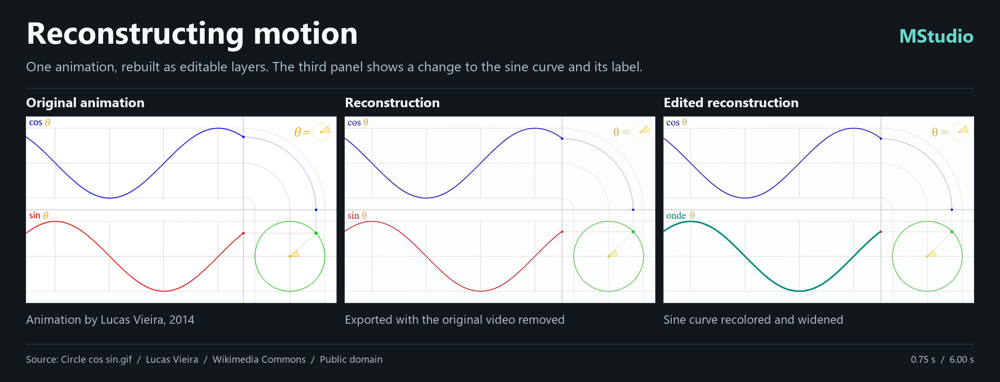

# MStudio

Un studio Windows pour monter et réviser des vidéos Remotion : prévisualisation du code avant export, timeline, storyboard et demandes de modification adressées à l’agent depuis une image précise. MStudio succède à Coulisses et peut être installé à côté de celui-ci.

**[Télécharger MStudio pour Windows x64](https://github.com/jeaxindr-dotcom/MStudio/releases/latest)** · [English](README.md)

## Partir d’une vidéo

| Action dans la bibliothèque | Ce que tu peux modifier | Ce qui alimente le rendu |
| --- | --- | --- |
| **Découper en plans** | Coupes, ordre, cadrage, titres, régions découpées | Les segments du film d’origine |
| **Reconstruire en Remotion** | Textes, formes, tracés, couleurs, déplacements et animation | Une nouvelle scène React/SVG et, si nécessaire, une piste son séparée |

Le second mode est destiné au motion design. Ton **Codex CLI** connecté peut observer les images et écrire automatiquement les calques. Tu peux aussi remettre le brief à ton propre agent. MStudio rend la composition, la compare aux images de référence et consigne les approximations. Le mode ne récupère pas le modèle 3D d’un film, ses fichiers de conception ou les pistes séparées d’un mixage.

Sur [l’animation de Lucas Vieira publiée dans le domaine public](https://commons.wikimedia.org/wiki/File:Circle_cos_sin.gif), l’agent a construit 34 calques. Après retrait du MP4, les 120 images décodées du nouvel export sont identiques à celles du **premier rendu reconstruit**. L’ouverture du secteur jaune et les traits fins restent approximatifs. Changer la courbe du sinus en turquoise et modifier son libellé a changé les 120 images.

## Installer et ouvrir

Télécharge et lance `MStudio-Setup-0.2.3-win-x64.exe` dans les versions publiées. Il installe MStudio pour l’utilisateur courant, avec Node, FFmpeg, FFprobe et le moteur Remotion. Codex CLI est distinct et n’est requis que pour la reconstruction automatique. L’installateur n’est pas signé numériquement. Les projets compatibles gardent l’extension `.coulisses` ; les bibliothèques et installations de MStudio et de Coulisses restent indépendantes.

## Utiliser les sources

Compilation sous Windows : utilise de préférence un chemin de travail court, par exemple `C:\src\MStudio`. Si Inno Setup indique « Le chemin d’accès spécifié est introuvable » dans une arborescence profonde, rouvre le projet via un chemin court puis relance la commande de compilation ci-dessous.

- Ouvre la bibliothèque pour retrouver les espaces Revue, Montage et Storyboard. **Agent** conserve le contexte de l’image lorsqu’on lui envoie une modification ; **Scène** sert à la mise en scène dans les projets compatibles.
- Dans le moniteur **Code actuel**, **Résolution de lecture** propose Auto, 100 %, ¾, ½ et ¼. À ½, une scène 3D de 1920 × 1080 est dessinée en 960 × 540. Pour écouter et revoir un passage à la cadence du projet, place la tête de lecture au début et clique sur **Préparer 30 s**. La résolution choisie s’applique aussi à cette plage. **Revenir au direct** rouvre le code à l’image affichée. L’export utilise ses propres réglages.
- Dans **Scène → Éléments de la scène**, cherche un objet par son nom pour le sélectionner, même si un autre le masque. Double-clique sur son nom pour le cadrer, puis maintiens la molette et glisse pour tourner autour de lui. En **Caméra libre**, le clic gauche sélectionne ; maintiens la molette et glisse pour tourner, maintiens le bouton droit et glisse pour déplacer la vue, ou roule la molette pour zoomer. **Grille 3D** affiche le sol et la boussole sans modifier le film ni les captures de revue.
- Dans un projet reconstruit, ouvre `src/layers.json` pour les calques, `src/Scene.tsx` pour le code de dessin. Depuis le dossier du projet, `npm run studio` ouvre Remotion Studio et `npm run render` exporte la vidéo. Sur un autre poste, installe les dépendances du `package.json`.
- [Protocole de l’agent](AGENT.md) · [Contrat d’un projet Remotion](docs/FICHE-COULISSES-REMOTION.md) · [Reconstruire une vidéo, pas à pas](docs/RECONSTRUIRE-UNE-VIDEO-AVEC-REMOTION.md).

Pour compiler l’installateur Windows x64 depuis les sources : `pwsh -File app/package-mstudio.ps1` avec PowerShell 7. Les fichiers sont écrits dans `.cache/mstudio-release/`. Les versions antérieures de Coulisses restent dans l’historique des publications. [Licence du code](LICENSE) ; les composants embarqués conservent leurs licences.
