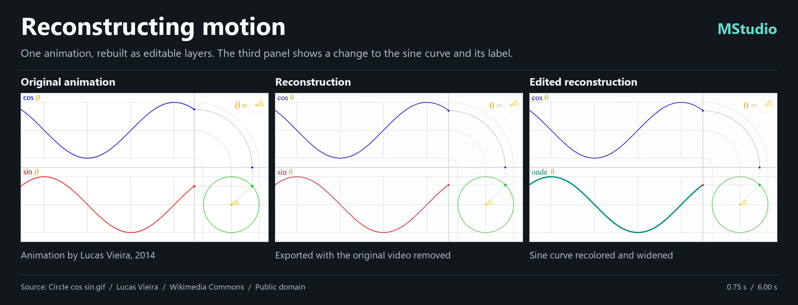

# MStudio

A Windows desktop studio for editing videos made with Remotion. Review a composition before export, navigate its timeline, and send the coding agent notes tied to a frame. MStudio succeeds Coulisses and can run alongside an existing Coulisses installation.

**[Download MStudio for Windows x64](https://github.com/jeaxindr-dotcom/MStudio/releases/latest)** · [Français](README.fr.md)

## Use a video as a starting point

| Library action | What you can edit | What the export uses |
| --- | --- | --- |
| **Split into shots** | Cut points, order, framing, titles and cropped regions | Segments of the original footage |
| **Rebuild in Remotion** | Text, vector paths and shapes, colors, transforms and animation timing | A new React/SVG scene and an optional separate audio track |

Rebuild works best with motion graphics. A signed-in **Codex CLI** can analyze reference frames and author editable layers automatically. You can also hand the brief to your own agent. MStudio renders the result, compares it with sampled reference frames, and saves a report of differences and approximations. It does not recover a camera recording as a 3D scene, original design files, or separate audio stems.

Tested with [Lucas Vieira’s public-domain animation](https://commons.wikimedia.org/wiki/File:Circle_cos_sin.gif): the agent built 34 editable layers. With the input MP4 removed, a second render reproduced all 120 decoded frames of the **reconstructed** export. The reconstruction approximates the angle sweep and some fine lines; changing the sine curve to teal and editing its label changed all 120 frames.

## Windows installation

For a first installation, download and run `MStudio-Setup-0.2.7-win-x64.exe` from Releases. It installs for the current user and includes Node, FFmpeg, FFprobe and the Remotion engine. Codex CLI is separate and is only required for the automatic agent path. The installer is not digitally signed. Existing Coulisses installations and libraries are independent; compatible projects keep their `.coulisses` extension.

For subsequent versions, click **Update** in the library or an open project. Once the download is verified, choose **Restart and install now** or **Install next time MStudio opens**. **Cancel** dismisses the dialog and keeps the downloaded installer.

## Work with the project

When building on Windows, prefer a short checkout path such as `C:\src\MStudio`. If Inno Setup reports that it cannot find the path from a deeply nested checkout, reopen the project through a short path and rerun the build command below.

- The library opens projects in review, timeline and storyboard views. Use **Agent** for feedback tied to a frame, and **Scene** for staging where a project supports it.
- The library remembers project titles and folders even when a project is unavailable. If its `.coulisses` file points to a moved review folder, the library updates the link. Remotion projects can show a thumbnail rendered from their code before their first video export.
- In the **Current code** monitor, **Playback resolution** offers Auto, 100%, ¾, ½ and ¼. At ½, a 1920 × 1080 3D scene draws at 960 × 540. To review a passage with sound at the project frame rate, move the playhead to its start and click **Prepare 30 s**. Prepared ranges also use the selected resolution. **Return to live code** restores the displayed frame. Exports use their own settings.
- In **Scene → Scene elements**, search for an object by name to select it even when something else hides it. Double-click its name to frame it; hold the middle button and drag to orbit that object. In **Free camera**, left-click to select, hold the middle button and drag to orbit, right-drag to pan, and scroll to zoom. **3D grid** shows a ground plane and compass in the editor only; the film and review snapshots stay clean.
- In a rebuilt project, edit `src/layers.json` for geometry and keyframes or `src/Scene.tsx` for the React drawing code. Run `npm run studio` to preview or `npm run render` to export from its folder. The bundled engine is linked on the authoring machine; for a standalone copy, install the dependencies from its `package.json`.
- [Agent protocol](AGENT.en.md) · [Remotion project contract](docs/COULISSES-REMOTION-CONTRACT.md) · [Reconstruction workflow (French)](docs/RECONSTRUIRE-UNE-VIDEO-AVEC-REMOTION.md).

To build the x64 installer from source, use PowerShell 7 on Windows: `pwsh -File app/package-mstudio.ps1`. Build output is under `.cache/mstudio-release/`. Earlier Coulisses releases remain in the repository’s release history. [Source license](LICENSE); bundled components retain their own licenses.
